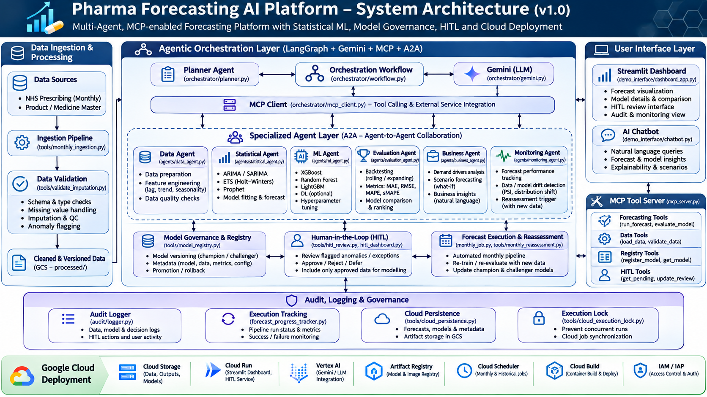

# Pharma Forecasting AI Platform

An agentic AI-powered pharmaceutical forecasting platform integrating statistical forecasting, machine learning, model governance, human-in-the-loop (HITL) review, and cloud-based orchestration.

## System Architecture

## Key Features

- Multi-product pharmaceutical demand forecasting
- Statistical and machine learning forecasting models
- Automated model evaluation and selection
- Champion and challenger model governance
- Agentic orchestration with Gemini and MCP
- Exception-based human-in-the-loop review
- Data validation and anomaly detection
- Forecast monitoring and audit logging
- Streamlit dashboard for forecasting intelligence
- Google Cloud integration

## System Architecture

The platform combines:

1. Data ingestion and validation
2. Statistical and ML forecasting agents
3. Backtesting and model evaluation
4. Model registry and governance
5. Agentic orchestration and tool execution
6. HITL review for flagged observations
7. Forecast monitoring and audit
8. Streamlit dashboard and AI-assisted insights

## Technology Stack

**Language:** Python

**Forecasting:** Statistical time-series models, scikit-learn, XGBoost

**Agentic AI:** Gemini, LangGraph, MCP

**Interface:** Streamlit

**Cloud:** Google Cloud Run, Cloud Storage, Vertex AI, Artifact Registry

## Repository Structure

- `agents/` — Forecasting and monitoring agents
- `orchestrator/` — Agent orchestration
- `tools/` — Forecasting, evaluation, registry, and HITL tools
- `audit/` — Audit logging
- `demo_interface/` — Streamlit dashboard and chatbot
- `cloud_job.py` — Cloud forecasting entry point
- `monthly_job.py` — Monthly processing entry point
- `mcp_server.py` — MCP server
- `hitl_dashboard.py` — HITL interface

## Project Status

**Version:** 1.0

Initial source-code release. Further improvements to the dashboard, forecasting models, and agentic architecture will be tracked through Git commits.

## Data and Security

Datasets, credentials, audit records, and generated forecasting outputs are excluded from this public repository.

The platform requires appropriate Google Cloud configuration and permissions for cloud execution.
